# The GenCP project

Generative Control Point

The GenCP project has been funded by ESA (European Space Agency).


## Introduction

The scope of this project is to develop a proof of concept prototype aiming to provide Generated Control Point (GenCP) image chips which are computed with generative AI techniques. The Ground Control Points (GCP) are involved in geometric Calibration / Validation activities of remote sensing images and are reference measurements.

The following picture illustrates the GenCP concept: image translation from map to synthetic satellite image

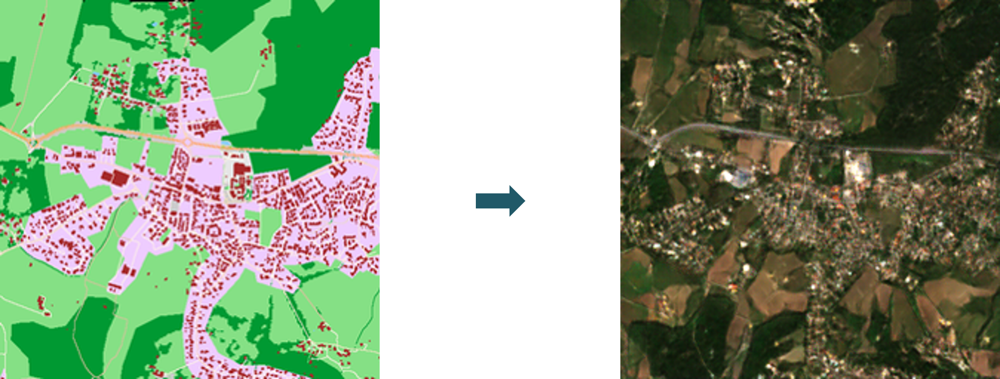


Currently, there are two common approaches to get GCP set:
*	Ground-based surveys, mostly using GNSS receivers with mm/cm level accuracy, that are suitable for manual labelling in images
*	Extraction from reference raster datasets, often Sentinel-2 mosaics (S2 GRI) or any other VHR images, for which uncertainties are known, and that is suitable for automatic image matching procedures.

In both cases, the reference points are provided to the user along with GCP image chips from an EO Sensor, including vector data and GNSS measurement (if available), or more straightforwardly a full raster reference data to sufficiently describe the point location. ESA is also aiming at the development and sharing of a comprehensive GCP DB, which requires clearly explained point locations together with accurate coordinates that need to be identified in the target image.

However, although the provision of GCP image chips is an efficient approach for user interpretation of a GCP in a target image (labelling), the sharing / distribution among community of original VHR data remain a critical issue because of copyright law / licensing policy.

Furthermore, even if some free ground photos or screenshots are available and so can be utilized as part of GCP description report, the photos or the views are not georeferenced, so GCP should be identified manually. As consequences, it limits considerably the usefulness of GCP data for geometric Cal/Val purposes.

The last but not least critical point is related to reference image chip; radiometric and geometric differences still exist between reference and target images; it results in accuracy loss in matching process.

In order to overcome these issues, an appropriate and ideal solution would be to generate synthetic GCP images, so called GenCP, with main purposes of using them as a geometric raster reference.

In the scope of this project, two AI models have been developed to support two different resolutions:
*	VHR with 50 cm images
*	HR with 10 m images

Further investigations were also carried out to address specific data quality issues identified during the project. For the HR model, the primary focus was the influence of terrain on synthetic image generation. To this end, Digital Elevation Models (DEMs) were incorporated into the GAN training pipeline to explicitly account for topography-driven radiometric and geometric effects. The secondary focus was the influence of seasonality on synthetic image generation. For this aspect, experiments on winter and summer seasons were done by encoding seasons in a constant channel incorporated into the GAN training pipeline.

A second line of work targeted the blurring artefacts observed in the VHR GenCP outputs. A new version of the AI model has been trained, Pix2Pix HD, to generate higher-quality and sharper VHR images. Location-aware image generation is also available for VHR image generation.


The following diagram illustrates the GenCP workflow:

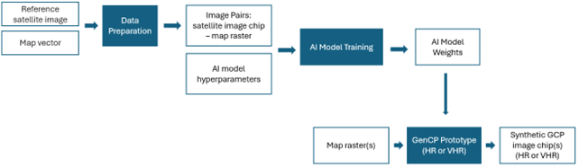

Note: image patches used for training and generated images are 8 bits images.


### Examples of generated images

Test datasets are available on [ZENODO GenCP page](https://zenodo.org/records/15044428).

Below are some examples of HR generated images along with the corresponding reference S2 patches and OSM rasters.

OSM raster            |  Reference Image            |  Generated Image
:-------------------------:|:-------------------------:|:-------------------------:
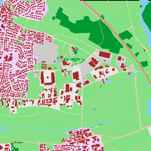  |  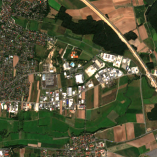 |  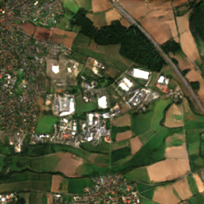
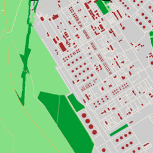  |  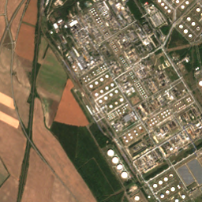 |  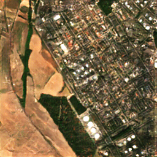
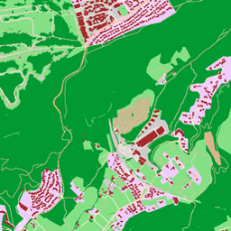  |  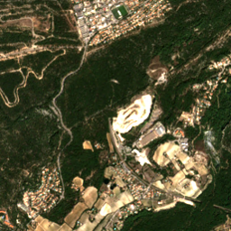 |  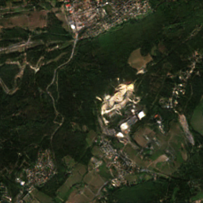
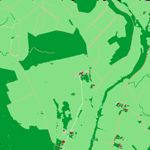  |  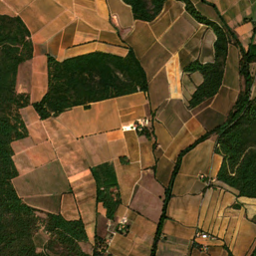 |  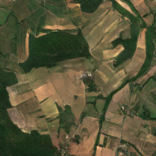
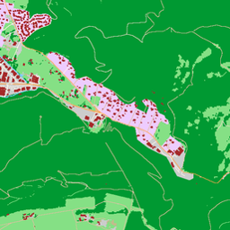  |  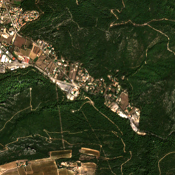 |  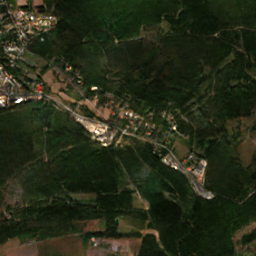

VHR examples are illustrated below, from UAV images.

OSM raster            |  Reference Image            |  Generated Image
:-------------------------:|:-------------------------:|:-------------------------:
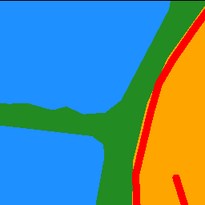  |  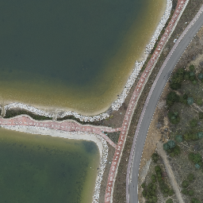 |  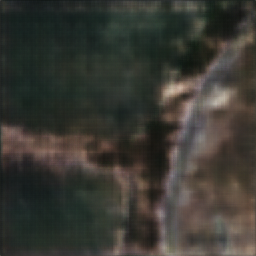
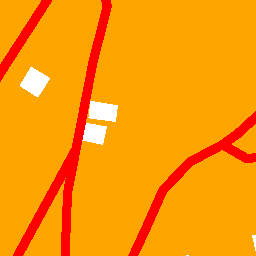  |  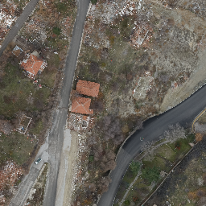 |  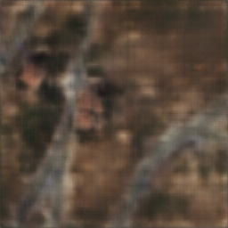
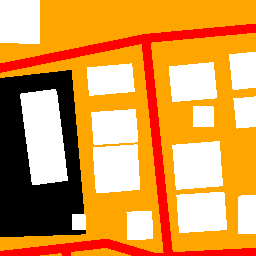  |  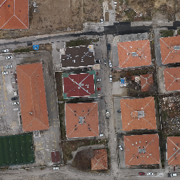 |  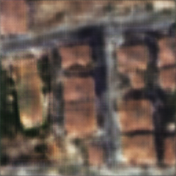
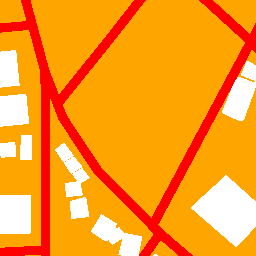  |  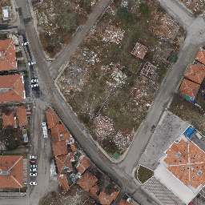 |  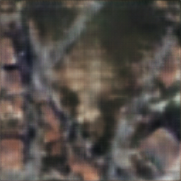
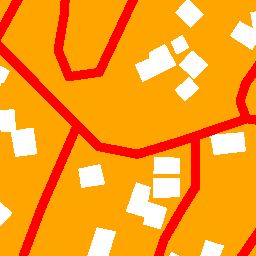  |  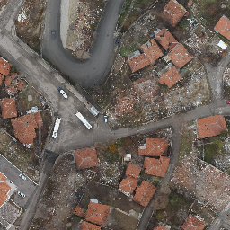 |  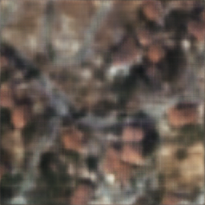


## Demo Notebooks

Notebooks are available to demonstrate how to generate synthetic [HR](GenCP_HR_demo/GenCP_demo_HR.ipynb) / [HR with topography](GenCP_HR_demo/GenCP_demo_HR_topography.ipynb) / [HR with seasonality](GenCP_HR_demo/GenCP_demo_HR_seasonality.ipynb). VHR training and inference notebooks are provided in [GenCP_VHR_pix2pixHD](GenCP_VHR_pix2pixHD/README.md).

Demonstration data is available for [HR](GenCP_HR_demo/data); the VHR test dataset is linked from the [GenCP_VHR_pix2pixHD README](GenCP_VHR_pix2pixHD/README.md). The notebooks can also be used on users' OSM rasters. Please refer to the [data section](#data) to see guidelines on how to generate OSM rasters compatible with the models' weights provided.


## Data

For HR images, we provide a training dataset of image pairs (S2 patches and corresponding OSM rasters), available in [Zenodo](https://zenodo.org/records/15044428).

To generate your own OSM rasters, follow the [VHR](GenCP_data_preparation/VHR/README.md) and [HR](GenCP_data_preparation/HR/README.md) guidelines for data preparation.


## AI model: Pix2Pix

This project is based on : [CycleGAN and pix2pix in PyTorch](https://github.com/junyanz/pytorch-CycleGAN-and-pix2pix). Please refer to the original repository for more information. Pix2Pix is explained in the following papers:

* [Unpaired Image-to-Image Translation using Cycle-Consistent Adversarial Networks](https://arxiv.org/pdf/1703.10593). Jun-Yan Zhu*, Taesung Park*, Phillip Isola, Alexei A. Efros. In ICCV 2017. (* equal contributions)

* [Image-to-Image Translation with Conditional Adversarial Networks](https://arxiv.org/pdf/1611.07004). Phillip Isola, Jun-Yan Zhu, Tinghui Zhou, Alexei A. Efros. In CVPR 2017.

The original code is licensed under the **BSD 3-Clause License**, and all copyright notices have been retained.

Minor changes have been made to add the LPIPS loss option for training.

### AI model: pix2pixHD (VHR)

The latest VHR model is trained with [NVIDIA pix2pixHD](https://github.com/NVIDIA/pix2pixHD) rather than pix2pix. It uses a different architecture (a coarse-to-fine generator, a multi-scale discriminator and a VGG feature-matching loss), so it lives in its own directory, [GenCP_VHR_pix2pixHD](GenCP_VHR_pix2pixHD/README.md), instead of in the `models/` registry.

GenCP adds geographic conditioning at the generator bottleneck: the centre of each input tile is converted to unit-sphere XYZ coordinates, read from a `geo_coordinates.csv` file, and injected through a small MLP before the residual blocks. Inputs and outputs remain RGB images.

* Training and inference are run from `notebooks/train.ipynb` and `notebooks/test.ipynb`, which call the `train.py` and `test.py` entry points.
* `generate_coordinate_csv.ipynb` builds the coordinate CSV from the OSM GeoTIFF tiles (requires GDAL).
* `notebooks/test.ipynb` also georeferences the generated tiles from the matching OSM GeoTIFFs and merges them into mosaics.

Installation, dataset layout and pretrained weights are described in the [GenCP_VHR_pix2pixHD README](GenCP_VHR_pix2pixHD/README.md). pix2pixHD is BSD-licensed, and its copyright notice is retained in `GenCP_VHR_pix2pixHD/LICENSE.txt`.


### Training

The script train.py launches the training with the given parameters.

## RGB mode

For training on an aligned dataset, meaning a dataset that contains images pairs saved as 1 images, the following options and command can be used:

* Use `--dataroot` to indicate path to training dataset
* Use `--name` to name the experiment
* Use `--checkpoints_dir` to indicate path to checkpoints folder for saving model's weights
* Use `--direction BtoA` to change input and output domain from B to A (A to B by default)
* Use `--LPIPS` to replace L1 loss by LPIPS loss
* Use `--lambda_L1` to change lambda value (with L1 or LPIPS loss)

Set `--model` option to "pix2pix" to indicate that a Pix2Pix architecture is used.

All options to select parameters and hyperparameters values are described in the [options folder](options).

```
   python train.py  --dataroot path/to/dataset  --name experiment_name --model pix2pix  --checkpoints_dir path/to/checkpoint_dir --direction BtoA
   
```
## RGB + Topography mode

For training on an unaligned dataset containing RGB map rasters and grayscale a DEM or Hillshades layer as inputs, the same options as for RGB mode are available. Required values for this mode are listed below:

* Option `--dataset_mode` should be set to "dem" to indicate that DEM dataloader should be used. 
* Option `--direction` default setting should be used ("AtoB").
* Option `--input_nc` should be set to "4" (RGB map raster are concatenated with topography layer (DEM or Hillshades)).
* Option `--output_nc` should be set to "3" (generated images are RGB images).

The dataset holds `A/` (map rasters), `B/` (real images) and a topography folder named `DEM/` or `TOPO/`, matched by file name. `--dataroot` can point to the split root (`<dataroot>/train/`, `<dataroot>/test/`, as written by `create_train_test_split --mode topography`) or directly to one phase folder.

If visualization issues are encountered, set option `--display_id` to "0" to disable visualization during training.

```
   python train.py  --dataroot path/to/dataset  --name experiment_name --model pix2pix --checkpoints_dir path/to/checkpoint_dir --dataset_mode dem --input_nc 4 --output_nc 3
   
```

## RGB + seasonal mode

The season is given to the generator as a constant 4th input channel (-1 for winter, +1 for summer), so one model generates both seasons. Two training modes are available; they use the same folders but different models:

| | Seasonal pix2pix | Seasonal pix2pix with stability loss |
| --- | --- | --- |
| `--model` | `pix2pix` | `pix2pix_stability` |
| `--dataset_mode` | `seasonal_paired_folders` | `seasonal_geokey` (default of `pix2pix_stability`) |
| Training sample | one (A, B) pair of one season | the summer and winter pairs of the same area |
| Losses | GAN + L1 | GAN + L1 on both seasons, plus stability and edge losses |
| Areas with a single season | used | ignored (an area must be in all 4 folders) |
| File names | any name, identical for A and B within a season | any name, identical for A and B and for both seasons; a trailing `_summer` / `_winter` is ignored |

**Which one to use**
* Use **seasonal pix2pix** to condition the generation on the season, with all the available chips, including areas acquired in one season only.
* Use **pix2pix with stability loss** when summer and winter images of the same area must keep the same geometry, which matters for control points: vegetation may change between seasons, but buildings, roads and water should not move. At each iteration both seasons of the same area are generated with the same crop and flip, and two losses are added on the "rigid" areas of the OSM raster (buildings, roads, water):
  * `--lambda_stab` (default 10): difference between the edges of the generated summer and winter images
  * `--lambda_edge` (default 5): difference between the edges of the generated images and of the OSM raster

The two modes are not interchangeable: `pix2pix` cannot read a `seasonal_geokey` dataset and `pix2pix_stability` cannot read a `seasonal_paired_folders` one.

Common options for both modes:
* Option `--direction` default setting should be used ("AtoB").
* Option `--input_nc` should be set to "4" (RGB map raster + season channel).
* Option `--output_nc` should be set to "3" (generated images are RGB images).

If visualization issues are encountered, set option `--display_id` to "0" to disable visualization during training.

Seasonal pix2pix:

```
   python train.py  --dataroot path/to/dataset  --name experiment_name --model pix2pix --checkpoints_dir path/to/checkpoint_dir --dataset_mode seasonal_paired_folders --input_nc 4 --output_nc 3
   
```

Seasonal pix2pix with stability loss:

```
   python train.py  --dataroot path/to/dataset  --name experiment_name --model pix2pix_stability --checkpoints_dir path/to/checkpoint_dir --input_nc 4 --output_nc 3 --lambda_stab 10 --lambda_edge 5
   
```

The output of the HR seasonal split (`create_seasonal_train_test_split`, see the [HR guidelines](GenCP_data_preparation/HR/README.md#post-processing-traintest-split)) can be used as is by both modes, with GRI chips (e.g. `31TEJ_0451_00`) as well as full-tile chips (`T<MGRS>_tile_<col>_<row>`).

Two other dataset layouts can be used with `--model pix2pix`: "seasonal_aligned" reads side-by-side A|B images from `summer/` and `winter/` folders (same convention as the aligned mode), and "seasonal_unaligned" reads unpaired images from the `A_<season>` / `B_<season>` folders.

Both seasonal models are used the same way for inference (see [Testing](#testing), RGB + seasonal mode).


### Testing

The script test.py tests the model. 

## RGB mode

For testing on test image pairs the following options and command can be used:

* Use `--dataroot` to indicate path to test dataset
* Use `--name` to indicate the name of the AI model to use
* Use `--checkpoints_dir` to indicate path to checkpoints folder
* Use `--results_dir` to indicate path to output folder for saving generated images
* Use `--direction BtoA` to change input and output domain from B to A (A to B by default)
* use `--num_test` to specify number of test images to process
* use `--dataset_mode` to specify the dataset mode: aligned or unaligned

Set `--model` option to "pix2pix" to indicate that a Pix2Pix architecture is used.

All options are described in the [options folder](options).

```
   python test.py  --dataroot path/to/dataset --name experiment_name --model pix2pix --direction BtoA --results_dir /path/to/result_dir --checkpoints_dir path/to/checkpoint_dir
   
```

For testing on source images only (map rasters), run the following command:

* Set `--model` to "test" to indicate testing mode
* Set `--dataset_mode` to "single" to indicate that only OSM rasters will be provided as inputs
* Set `--norm` to "batch" to indicate that batch normalization has been used during training
* Set `--netG` to "unet_256" to indicate that U-Net 256 was used as backbone for the generator during training

```
   python test.py  --dataroot path/to/dataset --name experiment_name --model test --results_dir /path/to/result_dir --checkpoints_dir path/to/checkpoint_dir --dataset_mode single --norm batch --netG unet_256
   
```

## RGB + Topography mode

For testing on an unaligned dataset containing RGB map rasters and grayscale a DEM or Hillshades layer as inputs, the same options as for RGB testing mode are available. Required values for this mode are listed below:

* Option `--model` should be set to "test" to indicate testing mode.
* Option `--dataset_mode` should be set to "dem_single" to indicate that DEM dataloader single mode should be used. 
* Option `--direction` default setting should be used ("AtoB").
* Option `--input_nc` should be set to "4" (RGB map raster are concatenated with topography layer (DEM or Hillshades)).
* Option `--output_nc` should be set to "3" (generated images are RGB images).
* Option `--norm` should be set to "batch" to indicate that batch normalization has been used during training.
* Option `--netG` should be set to "unet_256" to indicate that U-Net 256 was used as backbone for the generator during training.

The test folder holds `A/` and `DEM/` (or `TOPO/`); as for training, `--dataroot` can be the split root or the test folder itself.

```
   python test.py  --dataroot path/to/dataset --name experiment_name --model test --dataset_mode dem_single --results_dir /path/to/result_dir --checkpoints_dir path/to/checkpoint_dir --norm batch --netG unet_256 --input_nc 4 --output_nc 3
   
```

## RGB + seasonal mode

For generating images from RGB map rasters with a model trained in either seasonal mode (`pix2pix` or `pix2pix_stability`), the same options as for RGB testing mode are available. The input folder only contains map rasters; run the command once per season. Required values for this mode are listed below:

* Option `--model` should be set to "test" to indicate testing mode.
* Option `--dataset_mode` should be set to "seasonal_single" to indicate that seasonal dataloader single mode should be used. 
* Option `--direction` default setting should be used ("AtoB").
* Option `--input_nc` should be set to "4" (a constant season layer is added during data loading (-1 for winter, 1 for summer)).
* Option `--output_nc` should be set to "3" (generated images are RGB images).
* Option `--norm` should be set to "batch" to indicate that batch normalization has been used during training.
* Option `--netG` should be set to "unet_256" to indicate that U-Net 256 was used as backbone for the generator during training.
* **Option `--season` to specify winter or summer season for the generation.**

```
   python test.py  --dataroot path/to/dataset --name experiment_name --model test --dataset_mode seasonal_single --results_dir /path/to/result_dir --checkpoints_dir path/to/checkpoint_dir --norm batch --netG unet_256 --input_nc 4 --output_nc 3 --season summer
   
```


### Geo-referencing

Images generated by the AI model are not georeferenced. Use the following command to georeference generated images based on corresponding OSM rasters and create a GenCP database:

```
   python gencp_georeferencing.py -t "path/to/generated/images" -i "path/to/input/OSM/rasters" -o "path/to/output/genCP_DB"
   
```

Generated images are matched to OSM rasters by name: `<name>_fake.png` (`--model test`) or `<name>_fake_B.png` (`--model pix2pix`) is georeferenced from `<name>.tif`. The pixel size is rescaled when the generated image is smaller than the OSM raster (e.g. 256 px outputs from 257 px rasters).

## Quality Control

Quality control is done with [KARIOS](https://github.com/telespazio-tim/karios) to evaluate the geometric accuracy of the geo-referenced generated images.

### HR results

The following figure illustrates geometric error distribution results obtained with KARIOS on a test site (not used for training) for RGB HR generated images. Results show a mean error around 0.7 pixel (7m) and a RMSE around 2.5 pixels (24m) due to outliers, mostly in rural areas.

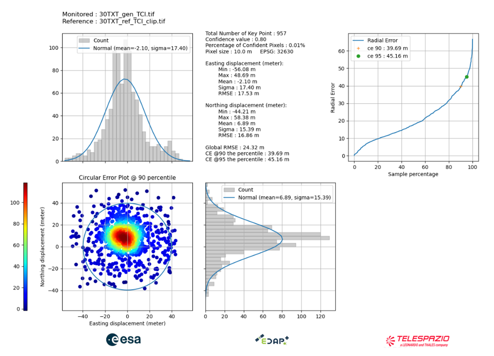

The following configuration was used:

Confidence value: 0.8

KLT Matching:
*	minDistance: 1
*	blocksize: 5
*	maxCorners: 0
*	matching_winsize: 15
*	quality_level: 0.1
*	xStart: 0
*	tile_size: 4000
*	laplacian_kernel_size: 7
*	outliers_filtering: true

### VHR results

The following figure illustrates geometric error distribution results obtained with KARIOS on a test site (not used for training) for RGB VHR generated images. Results show a mean error around 0.6 pixel and a RMSE around 3 pixels.

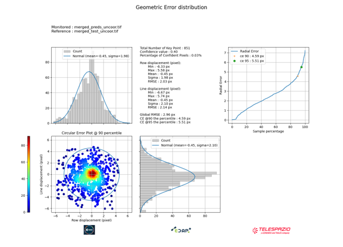

The following configuration was used:

KLT Matching:
*	minDistance: 1
*	blocksize: 25
*	maxCorners: 2000000
*	matching_winsize: 55
*	quality_level: 0.1
*	xStart: 0
*	tile_size: 5000
*  grid_step: 3
*	laplacian_kernel_size: 7
*	outliers_filtering: true

