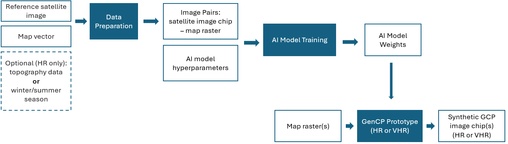

# GenCP

## Generative Control Points

AI-powered synthetic satellite image generation for geometric calibration and validation of remote sensing images.

GenCP is funded by ESA (European Space Agency).

**Code:** [github.com/telespazio-tim/GenCP](https://github.com/telespazio-tim/GenCP)


#### Image translation from map to synthetic satellite image

## What is GenCP?

Ground Control Points (GCP) are reference measurements used in geometric Calibration / Validation of remote sensing images. Traditional approaches rely on ground-based GNSS surveys or extraction from reference raster datasets such as Sentinel-2 mosaics.

These methods face challenges: VHR reference data cannot be freely shared due to copyright, ground photos lack georeferencing, and radiometric/geometric differences between reference and target images cause accuracy loss in matching.

GenCP solves this by generating synthetic GCP images using generative AI (Pix2Pix), translating OpenStreetMap rasters into realistic satellite imagery that can serve as geometric raster references.

## Two Resolution Tracks

#### HR — High Resolution (10m)

Sentinel-2 scale imagery with optional topography (DEM/hillshade) integration to account for terrain effects, and seasonal (summer/winter) generation.

* Mean geometric error: ~0.7 pixel (7m)
* RMSE: ~2.5 pixels (24m)

#### VHR — Very High Resolution (50cm)

Pix2PixHD model generating sharper 50 cm imagery, with optional location-aware generation (geographic coordinates injected at the generator bottleneck).

* Mean geometric error: ~0.6 pixel
* RMSE: ~3 pixels

## Workflow



## How to Use

The code, documentation and notebooks are available on GitHub: [telespazio-tim/GenCP](https://github.com/telespazio-tim/GenCP).

**1. Get the code**

```
git clone https://github.com/telespazio-tim/GenCP.git
cd GenCP
pip install -r requirements.txt
```

The VHR model has its own environment, described in the [GenCP_VHR_pix2pixHD README](https://github.com/telespazio-tim/GenCP/blob/master/GenCP_VHR_pix2pixHD/README.md).

**2. Prepare the input maps**

Build OSM rasters over your area of interest (and topography for the HR + DEM model) with the [HR](https://github.com/telespazio-tim/GenCP/blob/master/GenCP_data_preparation/HR/README.md) or [VHR](https://github.com/telespazio-tim/GenCP/blob/master/GenCP_data_preparation/VHR/README.md) data preparation guidelines.

**3. Generate synthetic images**

Run a trained model on the OSM rasters, or train your own on the Zenodo dataset: see [Testing](https://github.com/telespazio-tim/GenCP/blob/master/README.md#testing) and [Training](https://github.com/telespazio-tim/GenCP/blob/master/README.md#training) for the HR RGB, topography and seasonal modes.

**4. Georeference the results**

Generated images are not georeferenced: `gencp_georeferencing.py` copies the georeferencing of the input OSM rasters to build a GenCP database (see [Geo-referencing](https://github.com/telespazio-tim/GenCP/blob/master/README.md#geo-referencing)).

## Demo Notebooks

Interactive notebooks are available to get started quickly:

- [HR Demo](https://github.com/telespazio-tim/GenCP/blob/master/GenCP_HR_demo/GenCP_demo_HR.ipynb) - Generate 10m synthetic images
- [HR + Topography Demo](https://github.com/telespazio-tim/GenCP/blob/master/GenCP_HR_demo/GenCP_demo_HR_topography.ipynb) - HR with topography integration
- [HR + Seasonality Demo](https://github.com/telespazio-tim/GenCP/blob/master/GenCP_HR_demo/GenCP_demo_HR_seasonality.ipynb) - Summer / winter generation
- [VHR Pix2PixHD](https://github.com/telespazio-tim/GenCP/blob/master/GenCP_VHR_pix2pixHD/README.md) - Training and inference notebooks for VHR images


## Datasets

Training and test datasets are available on [Zenodo](https://zenodo.org/records/15044428).

---

## AI Model

GenCP is built on Pix2Pix (Image-to-Image Translation with Conditional Adversarial Networks). The original code is licensed under the BSD 3-Clause License. The VHR model builds on [NVIDIA pix2pixHD](https://github.com/NVIDIA/pix2pixHD) (BSD).

References:

- Isola et al., Image-to-Image Translation with Conditional Adversarial Networks, CVPR 2017.
- Zhu et al., Unpaired Image-to-Image Translation using Cycle-Consistent Adversarial Networks, ICCV 2017.
- Wang et al., High-Resolution Image Synthesis and Semantic Manipulation with Conditional GANs, CVPR 2018.


## Video

<video style="width: 80vw;" controls>
  <source src="genCP.mp4" type="video/mp4">
</video>
